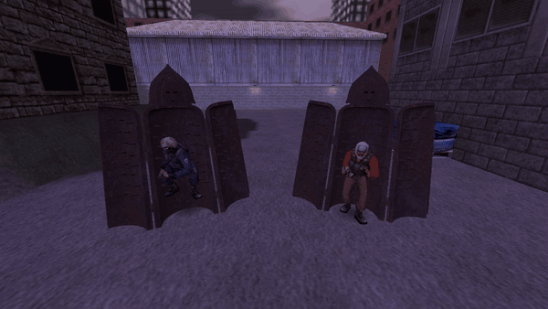

<h1 align="center">Iron Maiden</h1>

<p align="center">
  
</p>

## 📝 Description
This plugin adds placeable Iron Maidens to Counter-Strike 1.6, allowing players to trap and execute themselves or other players inside medieval torture devices.
- Place and configure Iron Maidens around the map
- Capture players inside the Iron Maiden with animated opening and closing doors
- Execute trapped players after a configurable holding duration
- Customize execution messages and forced execution messages
- Configure affected teams and usage restrictions by team
- Customize usage cooldowns and animation framerate
- Trigger screen shake effects during executions
- Play configurable opening, closing and execution sounds
- Display customizable HUD effects during executions
- Configure whether sounds and messages are displayed on death
- Save and load Iron Maiden placements per map
- Configure default behavior and create custom Iron Maiden presets

## 📋 Requirements
- ReGameDLL
- AMX Mod X 1.10+

## ⚙️ Configuration
```ini
# To add a new Iron Maiden, follow the example below:
# [Iron Maiden Name]
# MAIDEN_TEAM       = 0 - None, 1 - Terrorist, 2 - Counter-Terrorist, 3 - Both
# MAIDEN_COOLDOWN   = Minimum and maximum cooldown duration (MIN MAX)
#
# Define a section name to make an Iron Maiden available in the menu.
# Models and sounds cannot be changed dynamically during gameplay.
```

## 🔄 Changelog
```text
* v1.0: Initial release.
```

[](https://www.youtube.com/watch?v=FMxHiwpeoto)
